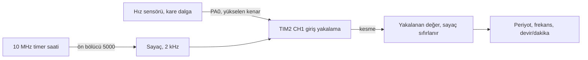

# STM32F407 ile frekans ve devir ölçümü (input capture)

> [TECH-OHM](https://tech-ohm.com) açık kaynak projesi

Bir hız sensöründen gelen darbelerin periyodunu timer'ın giriş yakalama (input capture) özelliğiyle ölçüp frekansa ve devir sayısına çeviren küçük bir örnek. Motor sürücülerinde hall ya da manyetik hız sensörünü okumak için yazdım.

## Blok diyagram



## Pinler

| Pin | Görev |
|---|---|
| PA0 | TIM2 CH1, sensör girişi |
| GND | sensörle ortak toprak |

Sensör çıkışı 3.3 V seviyesinde olmalı. 5 V ya da 12 V çıkışlı sensörlerde araya gerilim bölücü ya da optokuplör koy.

## Nasıl çalışıyor

TIM2 sayacı 2 kHz hızla sayıyor, yani bir tik 0.5 ms. Girişte her yükselen kenar geldiğinde timer o anki sayaç değerini yakalıyor ve kesme üretiyor. Kesme içinde yakalanan değer saklanıp sayaç sıfırlanıyor. Böylece her yakalama, bir önceki kenardan bu yana geçen süreyi veriyor.

Ana döngüde hesap şöyle:

```
periyot (s)   = tik sayısı / 2000
frekans (Hz)  = 1 / periyot
devir/dakika  = frekans * 60 / PULSES_PER_REV
```

İlk kenarda ölçüm alınmıyor, çünkü ondan önce referans olacak bir kenar yok. İki saniye boyunca hiç darbe gelmezse mil durmuş kabul edilip değerler sıfırlanıyor.

Sonuçlar `period_s`, `frequency_hz` ve `speed_rpm` değişkenlerinde. Debug sırasında Live Expressions penceresine ekleyip izleyebilirsin.

## Ölçüm aralığı

| | Değer |
|---|---|
| Çözünürlük | 0.5 ms |
| En düşük frekans | 0.5 Hz (2 s zaman aşımı) |
| Rahat ölçülen üst sınır | 50 Hz civarı |

Frekans yükseldikçe periyot birkaç tike iniyor ve hata büyüyor. 100 Hz'de periyot 20 tik, yani hata %5. Daha hızlı sinyaller için `.ioc` içinden TIM2 ön bölücüsünü küçült ve `TIMER_TICK_HZ` sabitini ona göre güncelle.

Sensör bir turda birden fazla darbe veriyorsa `PULSES_PER_REV` değerini değiştir.

## Derleme

STM32CubeIDE'de `File > Import > Existing Projects into Workspace` ile klasörü seç. İşlemci STM32F407VG, saat dahili osilatörden 80 MHz.

## Durum

Hesap kısmını düzenledikten sonra sensörle yeniden denemedim.

## Lisans

MIT. `Drivers` klasöründeki STM32 HAL ve CMSIS dosyaları kendi lisanslarıyla gelir.

## Yazar

Gömülü Sistem Mühendisi M. Eyüb Can, [TECH-OHM](https://tech-ohm.com) kurucusu

## TECH-OHM

[TECH-OHM](https://tech-ohm.com) elektronik kart ve gömülü yazılım tasarlayan bir mühendislik firması. Fikirden seri üretime kadar tasarım işi alıyor, TECH-OHM Akademi'de 12 aylık gömülü sistem eğitimi ve şirketlere özel danışmanlık veriyor.

Web: [tech-ohm.com](https://tech-ohm.com) · E-posta: info@tech-ohm.com
