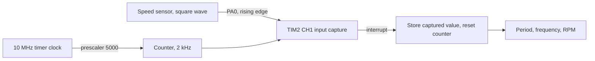

# Frequency and RPM measurement with timer input capture

STM32F407 · TIM2 input capture · speed sensor readout

   [](https://tech-ohm.com)

**English** | [Türkçe](README.tr.md) · An open-source project by [TECH-OHM](https://tech-ohm.com)

A small example that measures the period of pulses from a speed sensor with the timer's input capture feature and converts it to frequency and RPM. I wrote it to read hall and magnetic speed sensors on motor drives.

## Block diagram



## Pins

| Pin | Function |
|---|---|
| PA0 | TIM2 CH1, sensor input |
| GND | common ground with the sensor |

The sensor output must be at 3.3 V logic level. For 5 V or 12 V sensors put a divider or an optocoupler in between.

## How it works

The TIM2 counter runs at 2 kHz, so one tick is 0.5 ms. On every rising edge the timer latches the counter value and raises an interrupt. The handler stores the value and resets the counter, so each capture is the time since the previous edge.

The main loop does the math:

```
period (s)     = ticks / 2000
frequency (Hz) = 1 / period
rpm            = frequency * 60 / PULSES_PER_REV
```

The first edge gives no measurement because there is no earlier edge to measure from. If no pulse arrives for two seconds the shaft is treated as stopped and the values go to zero.

Results are in `period_s`, `frequency_hz` and `speed_rpm`. Add them to the Live Expressions view while debugging.

## Measurement range

| | Value |
|---|---|
| Resolution | 0.5 ms |
| Lowest frequency | 0.5 Hz (2 s timeout) |
| Comfortable upper limit | around 50 Hz |

As frequency rises the period shrinks to a few ticks and the error grows. At 100 Hz the period is 20 ticks, a 5% error. For faster signals lower the TIM2 prescaler in the `.ioc` file and update `TIMER_TICK_HZ` to match.

If the sensor gives more than one pulse per revolution, change `PULSES_PER_REV`.

## Build

In STM32CubeIDE use `File > Import > Existing Projects into Workspace` and select this folder. The clock is 80 MHz from the internal oscillator.

## Status

I reworked the calculation and have not re-tested with a sensor since.

## License

MIT. The STM32 HAL and CMSIS files under `Drivers` keep their own licenses.

## Author

M. Eyüb Can, embedded systems engineer and founder of [TECH-OHM](https://tech-ohm.com)

## About TECH-OHM

[TECH-OHM](https://tech-ohm.com) designs electronic boards and embedded software, from the first schematic to series production. We also run a 12-month embedded systems training program and consult for engineering teams.

Web: [tech-ohm.com](https://tech-ohm.com) · Email: info@tech-ohm.com
